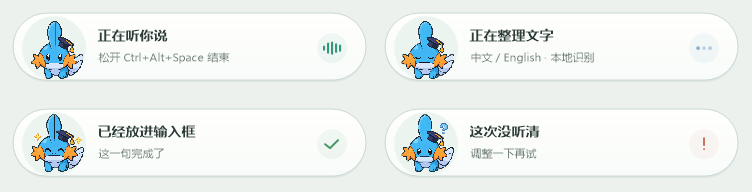

# Codex Voice Key · 按住说话，松开输入

给 Windows 版 Codex 加一个可自定义按键的**本地语音输入**：按住说话，松开后由
**Qwen3-ASR 1.7B** 识别中英文并放进输入框。配有暖白色平滑胶囊和戴博士帽的像素水跃鱼。

**不限于 Copilot 键。** 可用 `Ctrl+B`、`F8`、鼠标中键、两个鼠标侧键，或者自己的组合键。
默认是 `Ctrl+Alt+Space`。



## 最简单的部署方式

### 直接安装

1. 从 [Releases](https://github.com/SailTechnology/codex-voice-key/releases/latest)
   下载 **codex-voice-key-windows-x64.zip**。
2. 解压，双击 **Install.cmd**。
3. 打开 Codex，按住 `Ctrl+Alt+Space` 讲话，松开等待文字出现。

首次安装自动准备 Handy 和约 **1.5 GB** 的 Qwen 模型；下载完成后识别在本机运行，
不需要 API Key。无需管理员权限、Python、Node.js、Git 或 .NET SDK。
当前提供 **Windows 10/11 x64** 版本，使用系统内置的 .NET Framework。

国内网络可在解压目录运行：

```powershell
powershell.exe -NoProfile -ExecutionPolicy Bypass -File .\scripts\Install.ps1 -UseMirror
```

安装时就选择按键：

```powershell
.\scripts\Install.ps1 -Hotkey 'Ctrl+B'
.\scripts\Install.ps1 -Hotkey 'MouseX1'
.\scripts\Install.ps1 -Hotkey 'Copilot'
```

### 安装为 Codex skill

在 Codex 中直接说：

> 从 https://github.com/SailTechnology/codex-voice-key 安装
> `skills/codex-voice-key` 这个 skill，然后为我部署语音输入，把按键设为鼠标侧键 MouseX1。

也可以把 Release 中 **codex-voice-key-skill.zip** 内的 `codex-voice-key` 文件夹
放到你的 Codex 用户 skills 目录，再调用 **`$codex-voice-key`**。
本项目安装器会同步安装该 skill。Skill 由 `SKILL.md`、UI 元数据和可校验下载的部署脚本组成；
参见 [skill 源码](skills/codex-voice-key/SKILL.md) 和
[OpenAI 官方 skill 文档](https://learn.chatgpt.com/docs/build-skills)。

## 支持哪些按键

| 设置值 | 用法 |
| --- | --- |
| `Ctrl+Alt+Space` | 默认组合键 |
| `Ctrl+B`、`Ctrl+Shift+Space` | 自定义键盘组合 |
| `F8`、`F9`、`F24` | 单个功能键 |
| `MouseMiddle` | 鼠标中键 |
| `MouseX1`、`MouseX2` | 两个鼠标侧键 |
| `Ctrl+MouseX1` | 带修饰键的鼠标按钮 |
| `Copilot` | 识别物理 Copilot 键的 Win+Shift+F23 组合 |

**按住开始，松开结束**。长按重复事件不会反复启动录音。
仅在配置的目标应用前台时开始录音。普通自定义键在其他应用中保留原本功能；
选择 `Copilot` 时，该硬件组合会在全局保留给语音桥，避免弹出 Copilot。
不要把日常打字键或常用组合设成语音键，除非你确实想在 Codex 中占用它。
鼠标左/右键和单独的 Ctrl、Alt、Shift、Win 不作为语音键。

安装后随时改绑定：

```powershell
& "$env:LOCALAPPDATA\CodexVoiceKey\scripts\Set-Hotkey.ps1" -Hotkey 'MouseMiddle'
```

## 使用细节

- 胶囊显示聆听、转写、完成和出错四种状态，位于 **Codex 所在屏幕的任务栏上方居中**。
- 外框、圆角、文字、状态图标平滑绘制；只有角色是像素风，支持显示缩放。
- 默认开机登录自启，普通权限运行。安装参数 `-NoStartup` 可关闭创建启动项，
  `-NoStart` 可只安装而不立即运行。
- 使用 Windows 默认麦克风，自动尝试可用采样格式。识别前转换成 16 kHz 单声道。
- 转写完成时，只有原来的 Codex 窗口仍在前台才会粘贴；切换应用后文字留在剪贴板。
- **只粘贴，不自动发送**。转写文字会替换剪贴板内容。
- 默认不保留音频，成功、空结果和失败流程都会清理临时录音；可配置 `KeepRecordings`。
- 每次调用后端都会加载模型，冷启动可能需要几秒。识别率取决于麦克风、噪声与表达，
  请先在自己的设备上试说中文、英文或混合语句。

## 配置和诊断

默认目录：`%LOCALAPPDATA%\CodexVoiceKey`。主要设置在 `config.json`，修改后重启语音桥。
可参考 [完整配置示例](config.example.json)。

```powershell
& "$env:LOCALAPPDATA\CodexVoiceKey\scripts\Doctor.ps1"
```

诊断列出按键、目标进程、麦克风和 Handy 路径，不包含录音或转写内容。
麦克风可设为 `default`、诊断列出的设备编号、或者名称中的一部分。
若 Codex 的进程名不同，在 `TargetProcesses` 中添加对应的可执行文件名（不带 `.exe`）。
`TaskbarGap` 控制胶囊和任务栏的距离，默认 12 个逻辑像素。

若没有文字：先确认 Windows 允许桌面应用使用麦克风，检查 `voice-bridge.log`，
并确保 Codex 和语音桥使用相同权限级别。可用以下命令单独检查识别后端：

```powershell
& "$env:LOCALAPPDATA\CodexVoiceKey\CodexVoiceKey.exe" --transcribe-file '你的测试录音.wav'
```

此命令只转写文件，不录音、不粘贴。可附加 `--config '配置路径'`。
`--overlay-preview` 可以只预览界面，不录音、不安装键盘钩子。

## 升级与卸载

新版本重新运行安装器即可，现有按键和配置会保留，并备份上一版配置与程序。

```powershell
& "$env:LOCALAPPDATA\CodexVoiceKey\scripts\Uninstall.ps1"
```

卸载只删除安装清单内的程序文件和本程序的启动项。
配置、日志、skill、Handy 和共享模型保留，方便重装且不影响其他使用方。

## 从源码构建与验证

```powershell
.\scripts\build.ps1
.\scripts\Test.ps1
.\scripts\Package.ps1
```

只使用 Windows 自带的 C# 编译器。测试覆盖按键与修饰键事件序列、鼠标按钮、
长按、Win64 输入结构、Unicode JSON、音频转换，以及隔离目录中的安装、配置、
升级、诊断和卸载。测试不会向桌面注入按键、录制麦克风或修改真实启动项。
这类检查不能代替用户在自己电脑上的麦克风和硬件 Copilot 按键实测。

代码及 skill 使用 MIT 许可；水跃鱼形象是非官方同人素材，不包含在代码 MIT 授权中。
Handy、模型和角色信息见 [第三方说明](THIRD_PARTY_NOTICES.md)。

---

**English:** A Windows x64 push-to-talk companion for Codex. Hold a configurable
keyboard shortcut or mouse button, release to transcribe locally using Handy and
Qwen3-ASR, then paste without submitting. Download the release ZIP and run
`Install.cmd`, or install `skills/codex-voice-key` as a Codex skill. No API key,
administrator access, Python, Git or .NET SDK is needed on the target machine.
